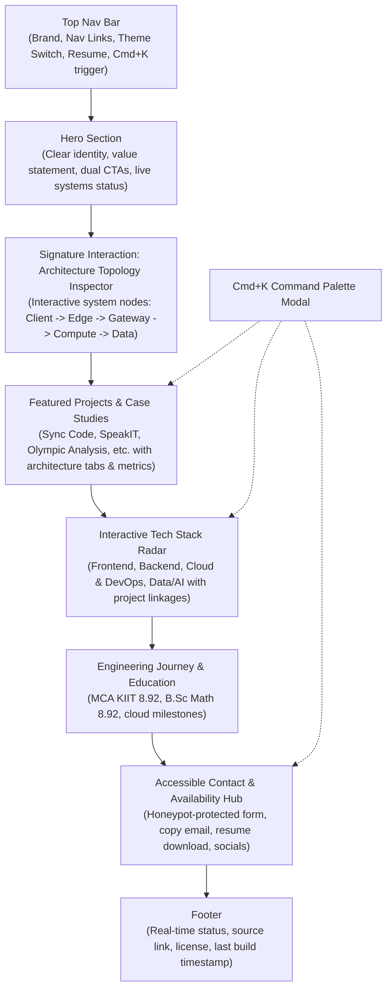

# Creative Direction: The Living Distributed System

**Project:** Mohd Mohitur Rahaman Portfolio Showcase  
**Chosen Concept:** **The Living Distributed System (Cloud Architecture & Systems Canvas)**  
**Version:** 1.0  
**Status:** Approved  

---

## 1. Concept Evaluation & Selection

We evaluated three distinct creative directions against four core criteria:
1. **Originality:** Does this avoid generic portfolio clichés?
2. **Relevance:** Does it authentically prove Mohitur’s backend, cloud, and data background?
3. **Performance Feasibility:** Can it achieve ≥95 Lighthouse Performance and <2.5s LCP on throttled mobile?
4. **Mobile Usability:** Is it effortless to browse on small touchscreens without awkward desktop metaphors?

| Concept | Originality | Relevance | Perf Feasibility | Mobile UX | Total / Verdict |
| :--- | :---: | :---: | :---: | :---: | :---: |
| **Concept A: The Living Distributed System** | **5/5** | **5/5** | **5/5 (Lean SVG/CSS/Canvas)** | **5/5 (Adaptive views)** | **20/20 (Selected)** |
| **Concept B: Developer OS & Windowed GUI** | 3/5 | 3/5 | 4/5 | 2/5 (Fails on small screens) | 12/20 (Rejected) |
| **Concept C: Minimal Editorial Magazine** | 3/5 | 3/5 | 5/5 | 4/5 | 15/20 (Rejected) |

### Why Concept A Won:
Mohitur's background combines **Mathematics (B.Sc Hons, 8.92 CGPA)**, **Full-Stack Engineering (MCA KIIT, 8.92 CGPA)**, **Cloud Infrastructure (AWS, Docker, Linux)**, and an active transition into **AI/GenAI Engineering**. A systems architecture theme directly reflects how he thinks: data flows, queues, serverless edge, compute nodes, and state synchronization.

---

## 2. Signature & Supporting Interactions

### 2.1 Signature Interaction: The Interactive Architecture Inspector
- **What it is:** A reactive systems topology map representing real projects and capabilities as interconnected system nodes:
  - `Client / React / Next.js` ➔ `Edge CDN / Cloudflare` ➔ `API Gateway & Spring Boot / Node` ➔ `Event Bus / Socket.io / Queues` ➔ `AI Engine / AWS Polly / Python Analytics` ➔ `Datastores / PostgreSQL / MongoDB`.
- **Interactivity:**
  - Visitors can select sample request payloads (e.g. *“Process Speech Synthesis”*, *“Sync Realtime Code”*, *“Run Olympic Analysis Model”*, *“Deploy Edge Cache”*).
  - Animated request packets flow through the system nodes in real-time.
  - Clicking any node opens the linked project, showcasing the exact architectural constraints, trade-offs, and GitHub repositories.
- **Progressive Enhancement & Fallback:**
  - On desktop: Full interactive SVG diagram with hover tooltips and physics-inspired particle traces.
  - On mobile / touch: Clean responsive flow cards with touch-friendly node taps.
  - On `prefers-reduced-motion`: Static, high-contrast topological diagram without motion or packet loops.

### 2.2 Supporting Interactions
1. **Quick-Access Command Palette (`Cmd+K` / `Ctrl+K`):**
   - Instant search across projects, technical skills, resume download, contact links, theme toggle, and keyboard shortcuts.
   - 100% accessible via keyboard (`Escape`, `ArrowUp`, `ArrowDown`, `Enter`) with ARIA modal semantics.
2. **Interactive Stack Radar / Skill Topology:**
   - Grouped visual taxonomy (Frontend, Backend & Systems, Cloud & DevOps, Data & AI) with live badge filters linking to real repository projects.
3. **Tactile Micro-Interactions & Copy-to-Clipboard Feedback:**
   - Smooth magnet-influenced buttons on fine pointers.
   - Interactive feedback toasts on email copy and resume download.

---

## 3. Cohesive Design System Tokens

### 3.1 Color System (Dual-Theme with System Sync)

#### Dark Theme ("Cosmic Blueprint" - Default)
- **Background Deep:** `#090d16` (Obsidian Blue)
- **Surface / Card:** `rgba(17, 24, 39, 0.7)` with `1px border: rgba(255, 255, 255, 0.08)`
- **Surface Elevated:** `#1e293b`
- **Text Primary:** `#f8fafc` (Slate 50)
- **Text Muted:** `#94a3b8` (Slate 400)
- **Accent Primary (Cyan Edge):** `#06b6d4`
- **Accent Secondary (Electric Emerald):** `#10b981`
- **Accent Highlight (Amber Pulse):** `#f59e0b`
- **Accent Violet (AI / Logic):** `#8b5cf6`

#### Light Theme ("Architect Paper")
- **Background Canvas:** `#f8fafc` (Slate 50)
- **Surface / Card:** `#ffffff` with `1px border: rgba(15, 23, 42, 0.08)`
- **Surface Elevated:** `#f1f5f9`
- **Text Primary:** `#0f172a` (Slate 900)
- **Text Muted:** `#475569` (Slate 600)
- **Accents:** High-contrast calibrated equivalents with WCAG AA compliance (contrast ratio ≥ 4.5:1).

### 3.2 Typography Scale
- **Display Face:** `Plus Jakarta Sans`, sans-serif (Weights: 600, 700, 800) - Geometric, technical, high-impact.
- **Body Face:** `Inter`, sans-serif (Weights: 400, 500, 600) - Highly legible at all sizes.
- **Monospace Face:** `JetBrains Mono`, monospace (Weights: 400, 600) - Clean code blocks and system metrics.

| Token | Size | Line Height | Tracking | Use Case |
| :--- | :--- | :--- | :--- | :--- |
| `text-display` | 3.5rem (56px) | 1.1 | -0.02em | Hero headline |
| `text-h1` | 2.5rem (40px) | 1.2 | -0.02em | Section titles |
| `text-h2` | 1.875rem (30px)| 1.25| -0.01em | Project titles, card headers |
| `text-h3` | 1.25rem (20px) | 1.4 | 0 | Subheadings, card titles |
| `text-body` | 1rem (16px) | 1.65| 0 | Paragraph copy, descriptions |
| `text-sm` | 0.875rem (14px)| 1.5 | 0.01em | Badges, tags, meta descriptions |
| `text-mono` | 0.8125rem (13px)|1.4 | 0 | Code badges, system stats |

### 3.3 Spacing & Radius
- **Spacing Scale:** Standard 4px-grid (`p-1` to `p-24`).
- **Radii:** `rounded-lg` (8px), `rounded-xl` (12px), `rounded-2xl` (16px), `rounded-3xl` (24px).
- **Elevation / Glows:** Subtle backdrop blurs (`backdrop-blur-md`), ambient edge borders (`ring-1 ring-white/10`).

### 3.4 Motion System
- **Durations:**
  - Micro-interactions (hover, click, icon toggles): **150ms**
  - Component entries / modal dialogs: **250ms - 300ms**
  - Section layout shifts / tabs: **350ms**
- **Easings:**
  - Standard ease-out: `cubic-bezier(0.16, 1, 0.3, 1)` (spring-like snappy stop)
  - Smooth enter: `cubic-bezier(0.25, 0.1, 0.25, 1)`
- **Precedence Rule:** All Motion components and CSS animations MUST check `useReducedMotion()`. If reduced motion is requested, all translation and scale effects are disabled, falling back to instant opacity or static displays.

---

## 4. One-Page Information Architecture & Interaction Map

---

## 5. Phase 2 Gate Check
- [x] Creative direction evaluated and approved against 4 strict criteria.
- [x] Tokens for colors, typography, spacing, and motion system defined.
- [x] Architecture topology signature interaction specified with progressive enhancement.
- [x] Styleguide page `/styleguide` planned for primitive inspection.
- [x] Gate status: **PASSED**. Proceeding to Phase 3: Foundation Setup.
